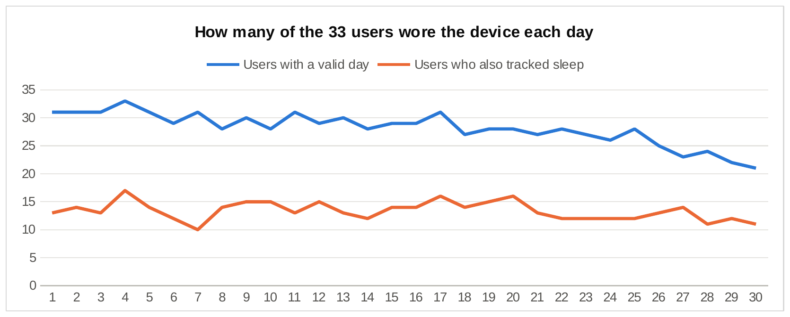
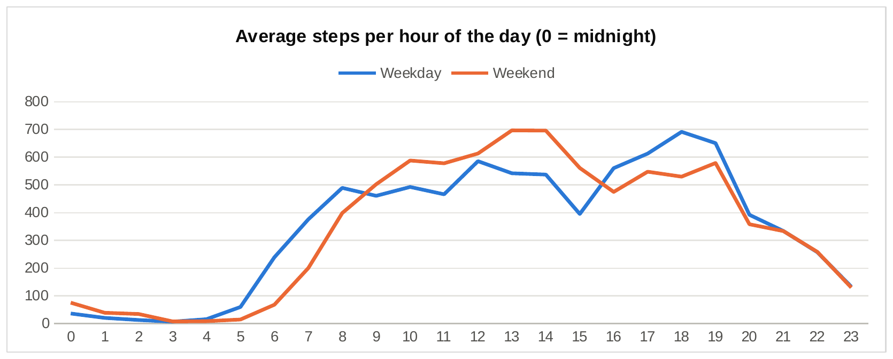
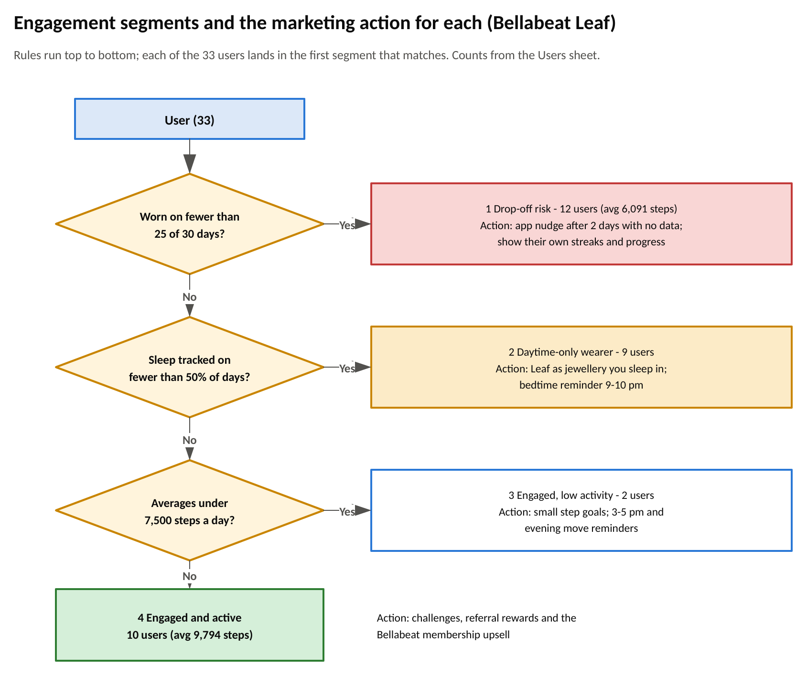

# Bellabeat: What Fitbit Users' Habits Mean for Bellabeat Leaf

**Eromosele Smart Ochie** · Google Data Analytics capstone, case study 2 · Excel (Power Query, pivot tables) · SQL (DuckDB) · Visio

📄 **Full report:** [report/Bellabeat_Case_Study_Report.docx](report/Bellabeat_Case_Study_Report.docx)

## The question

Bellabeat makes health-focused smart products for women. Its cofounder asked for **trends in how people use non-Bellabeat smart devices**, applied to one Bellabeat product, to guide marketing strategy. I chose **Bellabeat Leaf**, the tracker worn as a bracelet, necklace or clip.

## Data

- **FitBit Fitness Tracker Data** (Mobius on Kaggle, CC0; originally Furberg et al., 2016, Zenodo), folder `Fitabase Data 4.12.16-5.12.16`: daily activity, sleep, hourly steps / intensity / calories, minute-level sleep and weight logs. After cleaning: **33 users, 844 valid user-days**. The seven files used are in [data/raw/](data/raw/).
- **Added data:** a reference table of public-health benchmarks (CDC activity guideline, AASM/SRS sleep guideline, Tudor-Locke step categories, Paluch et al. 2022) in [data/reference/health_guidelines.csv](data/reference/health_guidelines.csv), so the Fitbit numbers can be judged against something.

## What I did

1. **Cleaned** in Power Query and SQL: converted date text, removed 546 duplicate rows, joined sleep to activity, and kept only valid days (worn, 10+ hours of data, not the partial export day).
2. **Found a measurement trap:** Fitbit stops counting activity minutes during sleep, so on nights the tracker isn't worn the whole night counts as "sedentary". Sedentary time is 12 hours on days with a sleep record and almost 20 on days without.
3. **Analysed** feature use, wear consistency over the month, activity against guidelines, time-of-day and day-of-week patterns, sleep timing and duration, with a per-user profile built from COUNTIFS / AVERAGEIFS.
4. **Segmented** users by engagement and drew the rules in Visio.



## Key findings

- **Automatic beats manual:** 100% of users recorded steps, 73% sleep, 24% weight.
- **The tracker comes off at night:** worn to bed on 47.5% of valid days; 9 users wore it daily but rarely or never to sleep.
- **Use fades fast:** daily wearers fell from 31 to 24 within a month (-22%); 36% of users wore it on fewer than 25 of 30 days, and they were the least active.
- **Moderately active, short of step targets:** 8,419 steps a day on average; 70% met the CDC's 150 active minutes a week but only 27% averaged 10,000 steps.
- **Predictable rhythm:** weekday peaks at lunchtime and 5-7 pm with a dip at 3 pm; most sleep starts between 9 pm and midnight.



## Recommendations for Bellabeat Leaf

1. **Sell Leaf as the tracker you don't take off** (jewellery you can sleep in), with a 9-10 pm bedtime reminder in the app.
2. **Run a first-30-days habit programme** in the Bellabeat app to stop the drop-off.
3. **Set realistic goals and time nudges:** 8,000 steps and 150 active minutes by default; reminders at 3 pm and before the evening peak.
4. **Keep tracking automatic and offer membership coaching** to users under 7,500 steps a day.



## Repository contents

| Path | What it is |
|---|---|
| `report/` | The written report (Word) |
| `excel/Bellabeat_Smart_Device_Analysis.xlsx` | Dashboard, Analysis, Users (per-user formulas, scorecard, segments), SQL_Results, Guidelines, Cleaning_Log, Business_Rules, Visio_Data, three pivot tables, clean daily and hourly tables |
| `sql/` | `01_load_raw` → `02_clean` → `03_analysis` → `04_quality_checks`; `run_all.sql` runs them in order |
| `power-query/` | The same cleaning as Power Query (M) queries |
| `visio/Bellabeat_Diagrams.vsdx` | Page 1 data flow, page 2 valid-day rules, page 3 engagement segments (PNG exports alongside) |
| `visuals/` | Charts exported from the workbook |
| `data/` | `raw/` source files, `reference/` benchmarks, `processed/` SQL outputs |

## Reproduce it

**SQL** (needs the DuckDB CLI):

```bash
cd bellabeat-smart-device-analysis
duckdb bellabeat.duckdb -c ".read sql/run_all.sql"
```

**Power Query:** create a text parameter `DataFolder` pointing at `data/raw/` (with a trailing backslash), add each `.pq` file as a blank query named after the file (`DailyActivity`, `SleepDay`, `Daily_Flagged`, ...), load `Daily_Clean` and `Hourly_Clean` over `tblDaily` and `tblHourly`, then Data > Refresh All. Expected row counts are in each file's header.

**Visio:** open `visio/Bellabeat_Diagrams.vsdx`, or rebuild the data-flow chart from the `Visio_Data` sheet with Visio Data Visualizer.

## Portfolio summary

Bellabeat, a maker of wellness trackers for women, wanted to know how people use other smart devices so it could sharpen its marketing. I cleaned a month of Fitbit data from 33 users with Excel Power Query and SQL, added public-health guidelines as a benchmark, and analysed feature use, wear consistency, activity and sleep in an Excel dashboard with pivot tables and per-user formulas, with the process and segment rules drawn in Visio. People track whatever is automatic, take the device off at night and drift away within weeks, and the least active users leave first. I recommended positioning Bellabeat Leaf as jewellery you can wear around the clock, a first-30-days habit programme in the app, realistic goals with well-timed nudges, and membership coaching for low-activity users.

---
Data: FitBit Fitness Tracker Data (Mobius, Kaggle, CC0). Bellabeat and its products are as described in the Google Data Analytics case study.
