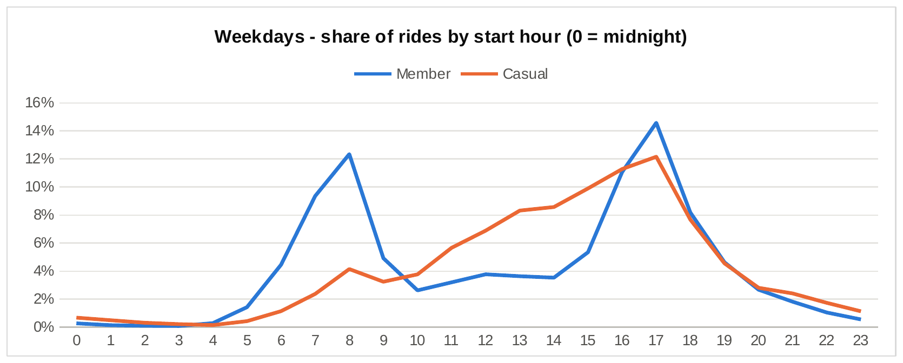
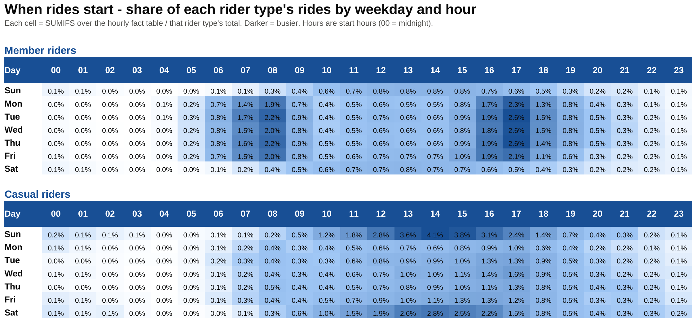
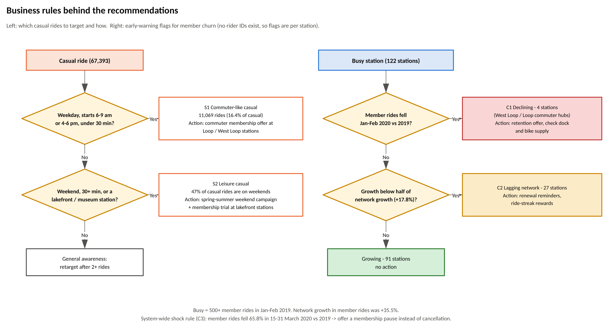

# Cyclistic Bike-Share: How Members and Casual Riders Differ

**Eromosele Smart Ochie** · Google Data Analytics capstone, case study 1 · Excel (Power Query, pivot tables) · SQL (DuckDB) · Visio

📄 **Full report:** [report/Cyclistic_Case_Study_Report.docx](report/Cyclistic_Case_Study_Report.docx)

## The question

Cyclistic's marketing director believes growth depends on converting casual riders into annual members. My task was to find out **how annual members and casual riders use the bikes differently**, so marketing can design that campaign.

## Data

Divvy (Chicago bike-share) trip data, the real data behind the fictional Cyclistic: `Divvy_Trips_2019_Q1.csv` (365,069 rows) and `Divvy_Trips_2020_Q1.csv` (426,887 rows). After cleaning: **783,799 rides**. Download links and checksums are in [data/raw/README.md](data/raw/README.md).

## What I did

1. **Cleaned** both files in Power Query and in SQL with the same five rules (test rides, missing ends, impossible or sub-60-second rides, rides over 24 hours), logging every removed row: 8,157 removed (1.0%).
2. **Checked** the result with eight automated quality checks; raw rows, removed rows, kept rows and the Excel fact table all reconcile.
3. **Analysed** trip duration, peak usage windows, day of week, month-by-month (seasonal) trends, stations, and year-over-year change, in SQL and in an Excel workbook with pivot tables, SUMIFS tables and a heatmap.
4. **Drew** the data flow and the business rules in Visio, driven from a process table in the workbook.



## Key findings

| | Members | Casual riders |
|---|---|---|
| Share of rides | 91.4% | 8.6% |
| Growth, Q1 2019 to Q1 2020 | +9.6% | +91.8% |
| Median ride | 8.5 min | 23.2 min |
| Rides over 30 min | 4.0% | 35.3% |
| Weekend rides | 16.6% | 47.4% |
| Round trips | 1.4% | 14.1% |

- Members ride like commuters: weekday peaks at 8 am and 5 pm, from West Loop stations next to the commuter-rail terminals.
- Casual riders ride for leisure: long weekend afternoon rides from lakefront and museum stations, and their share of rides doubles from January to March.
- **Conversion opportunity:** 11,069 casual rides (16%) already look like commutes.
- **Churn indicators:** member rides fell at 4 busy stations and lagged at 27 more while the network grew 35.5%; in late March 2020 member rides fell 66% against 41% for casual riders.



## Recommendations

1. **Commuter membership offer** for casual riders who already ride at rush hour, at Loop and West Loop stations.
2. **Spring-to-summer weekend campaign** at lakefront stations with a membership built for long leisure rides.
3. **Station-level churn early-warning report** and a membership pause option.



## Repository contents

| Path | What it is |
|---|---|
| `report/` | The written report (Word) |
| `excel/Cyclistic_Rider_Analysis.xlsx` | Dashboard, Analysis (SUMIFS over named ranges), Heatmap, Stations, SQL_Results, Cleaning_Log, Business_Rules, Visio_Data, four pivot tables, and the hourly fact table |
| `sql/` | `01_load_raw` → `02_standardize` → `03_clean` → `04_analysis` → `05_quality_checks`; `run_all.sql` runs them in order |
| `power-query/` | The same pipeline as Power Query (M) queries |
| `visio/Cyclistic_Diagrams.vsdx` | Page 1 data flow, page 2 cleaning rules, page 3 segment and churn rules (PNG exports alongside) |
| `visuals/` | Charts exported from the workbook |
| `data/processed/` | Every summary table exported by `04_analysis.sql` |

## Reproduce it

**SQL** (needs the DuckDB CLI and the two CSV files in `data/raw/`):

```bash
cd cyclistic-bike-share-analysis
duckdb cyclistic.duckdb -c ".read sql/run_all.sql"
```

**Power Query:** in Excel, create a text parameter `DataFolder` pointing at `data/raw/` (with a trailing backslash), then add each `.pq` file as a blank query (Data > Get Data > From Other Sources > Blank Query > Advanced Editor), using the file name without the number as the query name (`Trips2019_Std`, `Trips2020_Std`, `AllTrips_Flagged`, ...). Each file's header says how to load it and the row count to expect. Load `Fact_RidesHourly` over the `tblRidesHourly` table and choose Data > Refresh All.

**Visio:** open `visio/Cyclistic_Diagrams.vsdx`, or rebuild the data-flow chart from the `Visio_Data` sheet with Visio Data Visualizer (Cross-Functional Flowchart).

## Portfolio summary

Cyclistic, a Chicago bike-share company, wanted to know how its annual members and casual riders differ so it could convert casual riders into members. I cleaned and combined 791,956 Divvy trip records with Excel Power Query and SQL, documented every cleaning rule and checked that the row counts reconcile, then compared the two groups by ride length, time of day, day of week, month, station and year-over-year change in an Excel dashboard backed by pivot tables, and mapped the process and business rules in Visio. Members ride short weekday trips at commute times; casual riders take long weekend and afternoon rides from the lakefront, and their numbers nearly doubled in a year. I recommended a commuter membership offer for the 16% of casual rides that already look like commutes, a weekend campaign at lakefront stations, and a station-level churn early-warning report.

---
Data: Divvy trip data, Motivate International Inc., under the Divvy Data License Agreement. Cyclistic is the fictional company in the Google Data Analytics case study.
